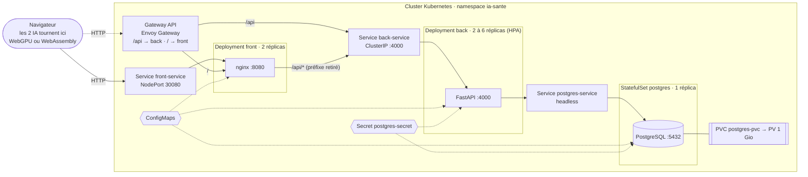
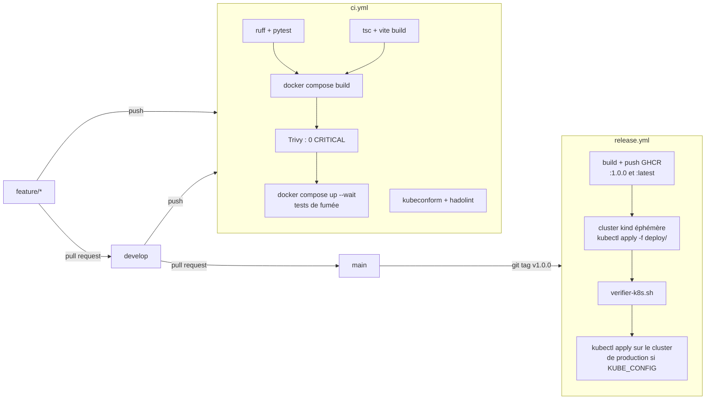
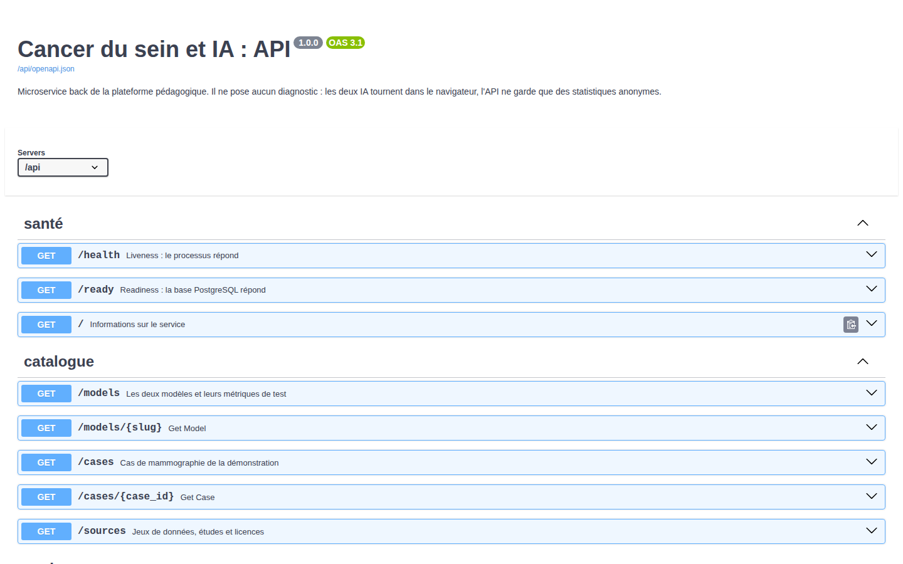

# Cancer du sein et IA : conteneurisation et orchestration

Projet du module **Conteneurisation & Orchestration** (ESILV). On prend une vraie application en ligne, la plateforme pédagogique
[« Le cancer du sein, expliqué. Et ce que l'IA y change vraiment »](https://yz-automation.fr/ia-sante/cancer-du-sein), on la découpe en
microservices, puis on la fait tourner avec **Docker**, **Docker Compose** et **Kubernetes**, avec une chaîne **CI/CD** GitHub Actions.

La plateforme explique le cancer du sein au grand public et fait tourner **deux modèles d'IA entraînés par nos soins**, directement dans
le navigateur (onnxruntime-web, WebGPU ou WebAssembly) :

| Modèle | Tâche | Données | AUC (test officiel) |
| --- | --- | --- | --- |
| EfficientNet-B0 affiné | Lésion de mammographie : plutôt bénigne ou plutôt maligne ? | CBIS-DDSM (CC BY 3.0), 704 lésions | 0,754 |
| Petit réseau résiduel (1,9 M paramètres) | Imagette de ganglion : métastase ou non ? | PatchCamelyon (CC0), 32 768 imagettes | 0,955 |

> **Page pédagogique, ce n'est pas un dispositif médical.** Elle ne pose aucun diagnostic et ne remplace pas l'avis d'un professionnel
> de santé. Aucune image n'est envoyée au serveur : les calculs ont lieu sur l'appareil du visiteur.

<p align="center"></p>

---

## Sommaire

1. [Architecture](#1-architecture)
2. [Structure du dépôt](#2-structure-du-dépôt)
3. [Prérequis (Windows + WSL 2 + Docker Desktop)](#3-prérequis)
4. [Démarrage rapide avec Docker Compose](#4-démarrage-rapide-avec-docker-compose)
5. [Déploiement Kubernetes](#5-déploiement-kubernetes)
6. [CI/CD GitHub Actions](#6-cicd-github-actions)
7. [Sécurité](#7-sécurité)
8. [Preuves de fonctionnement](#8-preuves-de-fonctionnement)
9. [Exigences du sujet, une par une](#9-exigences-du-sujet-une-par-une)
10. [Défis rencontrés et solutions](#10-défis-rencontrés-et-solutions)
11. [Pistes d'amélioration](#11-pistes-damélioration)
12. [Utilisation de l'IA](#12-utilisation-de-lia)

---

## 1. Architecture

Trois services, chacun dans son conteneur :

| Service | Rôle | Technologie | Image |
| --- | --- | --- | --- |
| **front** | Sert la plateforme (6 langues), les deux modèles ONNX, la lame de microscope ; relaie `/api` vers le back | Vite + TypeScript, servi par **nginx sans root** | `ghcr.io/yaniszedira/ia-sante-front` |
| **back** | API REST : catalogue des modèles et de leurs métriques, cas de mammographie, sources, journal **anonyme** des analyses et statistiques | **FastAPI** + SQLAlchemy, dépendances gérées par **uv** | `ghcr.io/yaniszedira/ia-sante-back` |
| **database** | Stockage des données de référence et du journal des analyses | **PostgreSQL 17** | `postgres:17-alpine` |



**Pourquoi ce découpage ?** Les modèles d'IA restent dans le navigateur : c'est un choix de confidentialité (aucune image médicale ne
quitte l'appareil) et d'échelle (le serveur ne paie pas le calcul). Le back ne reçoit donc que des métadonnées sans valeur personnelle
(modèle utilisé, score, durée, moteur, langue) et sert le catalogue. Le front affiche en pied de page un compteur venu de l'API ; si le
back tombe, la page continue de fonctionner sans le compteur.

**Points d'entrée de l'API** (documentation Swagger générée : `/api/docs`) :

| Méthode | Chemin | Rôle |
| --- | --- | --- |
| GET | `/health` | Liveness : le processus répond |
| GET | `/ready` | Readiness : PostgreSQL répond (`SELECT 1`), sinon 503 |
| GET | `/models`, `/models/{slug}` | Les deux modèles, leurs métriques (AUC, IC 95 %, seuil, sensibilité, spécificité) |
| GET | `/cases?type=mass\|calcification`, `/cases/{id}` | Les 11 cas de mammographie de la démonstration |
| GET | `/sources` | Jeux de données, études et licences |
| POST | `/analyses` | Enregistre une analyse (validation stricte, champs inconnus refusés) |
| GET | `/stats` | Total, répartition par modèle, type, langue, part WebGPU, durée moyenne |
| GET | `/` | Version et nom du pod qui a répondu (pratique pour voir la répartition de charge) |

---

## 2. Structure du dépôt

```text
.
├── back/                       # microservice API (FastAPI)
│   ├── app/                    #   main.py, routes/, models.py, schemas.py, seed/ (données de référence)
│   ├── tests/                  #   pytest (6 tests, base SQLite)
│   ├── Dockerfile              #   multi-étapes : builder (uv) → dev → runtime (non root)
│   ├── .dockerignore
│   └── pyproject.toml
├── front/                      # microservice web (Vite + TypeScript + onnxruntime-web)
│   ├── src/                    #   code de la plateforme, i18n (fr, en, es, ar, hi, zh), api.ts (lien avec le back)
│   ├── public/                 #   modèles ONNX, moteur WebAssembly, lame DZI, images
│   ├── nginx/                  #   modèle de configuration nginx (envsubst au démarrage)
│   ├── site/                   #   logo et police partagés avec le site principal
│   ├── Dockerfile              #   multi-étapes : deps → dev → build → runtime nginx (non root)
│   └── .dockerignore
├── deploy/                     # manifestes Kubernetes (kubectl apply -f deploy/)
│   ├── 00-namespace.yaml       #   namespace + Pod Security Admission
│   ├── 10-configmaps.yaml      #   configuration non sensible
│   ├── 20-postgres.yaml        #   PV + PVC + Service headless + StatefulSet
│   ├── 30-back.yaml            #   Deployment + Service ClusterIP
│   ├── 40-front.yaml           #   Deployment + Service NodePort
│   ├── 50-hpa-pdb.yaml         #   HorizontalPodAutoscaler + PodDisruptionBudgets
│   ├── 60-networkpolicies.yaml #   cloisonnement réseau
│   ├── gateway/                #   Gateway API (Envoy Gateway) : GatewayClass, Gateway, HTTPRoutes
│   ├── tests/                  #   test de charge k6 (Job + script)
│   └── examples/               #   modèle de Secret (jamais de vrai secret dans Git)
├── scripts/
│   ├── verifier-k8s.sh         # vérifications automatiques (utilisé aussi par la CI)
│   └── captures.py             # captures d'écran du README (Playwright)
├── docs/
│   ├── captures/               # captures d'écran
│   └── preuves/                # sorties brutes des tests (kubectl, k6, HPA, Trivy)
├── .github/workflows/          # ci.yml (develop, feature/*, PR) et release.yml (tags v*)
├── docker-compose.yml          # stack complète en une commande
├── docker-compose.dev.yml      # surcouche de développement (rechargement à chaud)
├── kind-config.yaml            # cluster local kind à un nœud
├── Justfile                    # raccourcis (just up, just all, just verify...)
├── .env.example                # modèle de configuration (le vrai .env est ignoré par Git)
└── .gitignore / .gitattributes
```

---

## 3. Prérequis

### Windows : WSL 2 puis Docker Desktop

Docker Desktop s'appuie sur **WSL 2** (un vrai noyau Linux dans une machine virtuelle légère, voir la partie 2 du cours).

1. **Installer WSL 2** ([documentation Microsoft](https://learn.microsoft.com/fr-fr/windows/wsl/install)) dans un PowerShell **administrateur** :
   ```powershell
   wsl --install            # installe WSL 2 et Ubuntu, puis redémarrer le PC
   wsl --set-default-version 2
   wsl -l -v                # Ubuntu doit apparaître avec VERSION 2
   ```
2. **Installer Docker Desktop** ([documentation Docker](https://docs.docker.com/desktop/setup/install/windows-install/)) en cochant
   « Use WSL 2 instead of Hyper-V ». Dans *Settings → Resources → WSL integration*, activer l'intégration avec Ubuntu.
3. **Vérifier**, depuis le terminal Ubuntu (WSL) :
   ```bash
   docker run hello-world
   docker compose version
   ```
4. **Kubernetes**, au choix :
   - **kind** (utilisé pour ce projet, et par la CI) : `go install sigs.k8s.io/kind@latest` ou le binaire de
     [kind.sigs.k8s.io](https://kind.sigs.k8s.io/docs/user/quick-start/#installation), plus `kubectl`.
   - **Kubernetes de Docker Desktop** : *Settings → Kubernetes → Enable Kubernetes*. Les images construites localement sont visibles
     par le cluster (pas besoin de `kind load`) et le NodePort répond sur `http://localhost:30080`.
   - **minikube** : `minikube start`, puis `minikube image load <image>` et `minikube service front-service -n ia-sante --url`.
5. Optionnel : [`just`](https://github.com/casey/just) pour les raccourcis du `Justfile`.

Espace disque à prévoir : environ 10 Go (WSL, Docker Desktop, images, cluster). Ce projet a été construit et testé sur un serveur
Linux (Ubuntu 24.04, Docker 29.8, Compose 5.5, kind 0.33, Kubernetes 1.37) faute de place sur le poste Windows : les commandes sont les
mêmes dans le terminal WSL.

---

## 4. Démarrage rapide avec Docker Compose

```bash
git clone https://github.com/YanisZedira/ia-sante-docker-kubernetes.git
cd ia-sante-docker-kubernetes
cp .env.example .env              # puis choisir un mot de passe POSTGRES_PASSWORD
docker compose up -d --build      # ou : just up
```

Ouvrir **http://localhost:8080/ia-sante/cancer-du-sein/**. L'API est sur `http://localhost:8080/api/` et sa documentation sur
`http://localhost:8080/api/docs`.

```bash
docker compose ps                 # les 3 services doivent être « healthy »
docker compose logs -f back       # journaux de l'API
docker compose down               # arrêt (ajouter -v pour supprimer aussi la base)
```

**Ce que fait le `docker-compose.yml`**

- `depends_on` avec `condition: service_healthy` : le back attend que PostgreSQL accepte les connexions (`pg_isready`), le front attend
  que le `HEALTHCHECK` du back passe. On évite le piège vu en cours : `depends_on` seul n'attend que le démarrage du conteneur.
- **Deux réseaux** : `frontend` (front ↔ back) et `backend` (back ↔ base). Le front n'a aucune route vers PostgreSQL.
- **Volume nommé** `database` : les données survivent à `docker compose down`.
- Secrets dans `.env` (ignoré par Git), avec un message d'erreur clair si le mot de passe manque (`${POSTGRES_PASSWORD:?...}`).
- Conteneurs en lecture seule (`read_only: true` + `tmpfs`), `no-new-privileges`, limites CPU/mémoire, `restart: unless-stopped`.
- Port publié sur `127.0.0.1` par défaut (`FRONT_BIND=0.0.0.0` dans `.env` pour l'ouvrir au réseau).

**Mode développement** (rechargement à chaud du front et du back, code monté en volume) :

```bash
docker compose -f docker-compose.yml -f docker-compose.dev.yml up --build     # ou : just dev
# front Vite : http://localhost:5181/ia-sante/cancer-du-sein/
```

### Les Dockerfiles

Les deux Dockerfiles suivent les bonnes pratiques du cours (images minimales, couches de dépendances en cache, multi-étapes, utilisateur
non root, `.dockerignore`) :

| | back | front |
| --- | --- | --- |
| Étapes | `builder` (uv crée `/opt/venv`) → `dev` (outils de test, `--reload`) → `runtime` | `deps` (`npm ci`) → `dev` (Vite) → `build` (`npm run build`) → `runtime` |
| Base finale | `python:3.13-slim` | `nginxinc/nginx-unprivileged:1.30-alpine` |
| Utilisateur | `app` (uid 10001) | `nginx` (uid 101), port 8080 non privilégié |
| Retiré de l'image finale | uv, compilateur, tests, **pip** | Node.js, `node_modules`, sources TypeScript |
| HEALTHCHECK | `GET /health` en Python (pas de curl dans slim) | `wget /healthz` |
| Taille (contenu) | **68,8 Mo** | **134 Mo**, dont 128 Mo de contenu servi (modèles 24 Mo, lame 72 Mo, moteur WebAssembly 32 Mo) |
| Vulnérabilités HIGH/CRITICAL corrigibles (Trivy) | **0** | **0** |

---

## 5. Déploiement Kubernetes

### En une commande

```bash
just all       # cluster kind + images + metrics-server + déploiement
```

### Pas à pas (sans `just`)

```bash
# 1. Cluster local à un nœud (le NodePort 30080 est publié sur localhost:8830)
kind create cluster --config kind-config.yaml

# 2. Images construites puis chargées dans le nœud (imagePullPolicy: IfNotPresent, pas de registre nécessaire)
docker build -t ghcr.io/yaniszedira/ia-sante-back:1.0.0  --target runtime back
docker build -t ghcr.io/yaniszedira/ia-sante-front:1.0.0 --target runtime front
kind load docker-image ghcr.io/yaniszedira/ia-sante-back:1.0.0 ghcr.io/yaniszedira/ia-sante-front:1.0.0 --name ia-sante

# 3. Namespace puis Secret, créé en ligne de commande : le mot de passe n'est jamais écrit dans Git
kubectl apply -f deploy/00-namespace.yaml
kubectl -n ia-sante create secret generic postgres-secret --from-literal=PGPASSWORD="$(openssl rand -hex 16)"

# 4. Tout le reste (les fichiers sont numérotés pour être appliqués dans le bon ordre)
kubectl apply -f deploy/
kubectl -n ia-sante get pods,svc,pvc,hpa -w
```

Ouvrir **http://localhost:8830/ia-sante/cancer-du-sein/** (kind) ou **http://localhost:30080/...** (Docker Desktop).

### Les objets déployés

| Objet | Fichier | Pourquoi |
| --- | --- | --- |
| `Namespace ia-sante` | `00-namespace.yaml` | Isole le projet ; Pod Security Admission `baseline` imposé, `restricted` signalé |
| `ConfigMap back-configmap`, `front-configmap` | `10-configmaps.yaml` | Configuration non sensible (hôte, port, utilisateur, base, URL du back) |
| `Secret postgres-secret` | créé par `kubectl create secret` | Mot de passe PostgreSQL, injecté dans le back (`envFrom`) et dans PostgreSQL (`secretKeyRef`) |
| `PersistentVolume` + `PersistentVolumeClaim` | `20-postgres.yaml` | 1 Gio, `storageClassName: manual`, `Retain` : les données survivent au pod et au PVC |
| `StatefulSet postgres` + `Service` headless | `20-postgres.yaml` | Identité et stockage stables pour la base |
| `Deployment back` + `Service ClusterIP` | `30-back.yaml` | 3 réplicas, initContainer qui attend PostgreSQL, sondes startup/liveness/readiness, `RollingUpdate maxUnavailable: 0`, `preStop` |
| `Deployment front` + `Service NodePort` | `40-front.yaml` | 2 réplicas, nginx en lecture seule, NodePort 30080 |
| `HorizontalPodAutoscaler` | `50-hpa-pdb.yaml` | Back de 2 à 6 pods selon le CPU (cible 60 %) |
| `PodDisruptionBudget` | `50-hpa-pdb.yaml` | Au moins un pod back et un pod front pendant une maintenance |
| `NetworkPolicy` | `60-networkpolicies.yaml` | Tout refusé par défaut ; ouverts : → front, front/gateway → back, back → PostgreSQL |
| `GatewayClass`, `Gateway`, `HTTPRoute` | `gateway/gateway.yaml` | Entrée HTTP unique par la Gateway API (successeur d'Ingress), comme dans l'exemple du cours |

Chaque conteneur applicatif tourne **sans root**, avec `readOnlyRootFilesystem`, `allowPrivilegeEscalation: false`, toutes les
*capabilities* retirées, `seccompProfile: RuntimeDefault`, sans jeton de compte de service, avec des `requests`/`limits` de CPU et mémoire.

### Gateway API (optionnel)

```bash
just gateway            # installe Envoy Gateway v1.10 puis applique deploy/gateway/
just gateway-forward    # http://localhost:8831 : /api → back, / → front
```

### Mise à l'échelle et test de charge

```bash
just metrics            # metrics-server (requis par le HPA)
just load-test          # Job k6 dans le cluster : 30 puis 60 utilisateurs pendant 3 minutes
just watch-hpa          # dans un autre terminal
```

### Démonstration de l'auto-réparation (soutenance)

```bash
kubectl -n ia-sante get pods -l component=back
kubectl -n ia-sante delete pod <un pod back>      # ou : just chaos
kubectl -n ia-sante get pods -l component=back -w # un nouveau pod est créé aussitôt
```

### Vérification complète

```bash
./scripts/verifier-k8s.sh            # ou : just verify
```

Le script contrôle les pages et l'API, le type MIME du moteur WebAssembly, la répartition de charge, les NetworkPolicy, la persistance
après suppression du pod PostgreSQL, l'auto-réparation et une mise à jour progressive **sous trafic, sans aucune erreur**.

---

## 6. CI/CD GitHub Actions

Branches : `main` (protégée, production), `develop` (intégration), `feature/*` (une fonctionnalité chacune, fusionnée dans `develop`
par pull request).



- **`ci.yml`** (push sur `develop` et `feature/*`, pull requests vers `develop` et `main`) : lint et tests de l'API, vérification des types
  et build du front, validation des manifestes (kubeconform) et des Dockerfiles (hadolint), build des images, scan Trivy bloquant sur
  les failles CRITICAL corrigibles, puis démarrage réel de la stack Compose et tests de fumée.
- **`release.yml`** (tag `vX.Y.Z` posé sur un commit de `main`, vérifié) : build et push des deux images vers **GitHub Container
  Registry** (`ghcr.io/yaniszedira/ia-sante-back:1.0.0`...), puis **déploiement Kubernetes par `kubectl apply`** sur un cluster kind
  créé dans le runner, avec les images du registre, et exécution de `verifier-k8s.sh`. Si un secret `KUBE_CONFIG` (kubeconfig en base64)
  est ajouté au dépôt, le même `kubectl apply` part vers ce cluster de production.

Aucun secret n'est nécessaire pour la CI : le push vers GHCR utilise le `GITHUB_TOKEN` fourni par GitHub, et les mots de passe de test
sont générés à la volée (`openssl rand`).

---

## 7. Sécurité

- **Aucun secret dans Git ni dans les images** : `.env` et `deploy/secret.yaml` sont dans `.gitignore`, `.env*` est exclu des contextes
  Docker par `.dockerignore`, le Secret Kubernetes est créé en ligne de commande, la CI génère ses mots de passe.
- **Moindre privilège** : utilisateurs non root, systèmes de fichiers en lecture seule, capabilities retirées, `no-new-privileges`,
  pas de jeton Kubernetes monté, Pod Security Admission.
- **Réseau** : deux réseaux Compose, NetworkPolicy « tout refusé par défaut » sous Kubernetes (le front ne peut pas joindre la base :
  vérifié par `verifier-k8s.sh`).
- **Images** : bases minimales, mises à jour de sécurité appliquées au build, pip retiré, scan Trivy dans la CI (0 HIGH/CRITICAL
  corrigible au 17/11/2026).
- **API** : validation Pydantic stricte (valeurs bornées, listes fermées, champs inconnus refusés), corps limité à 16 Ko par nginx.
- **Données personnelles** : aucune image, aucune adresse IP stockée ; seulement des statistiques anonymes.
- En-têtes HTTP de sécurité (`X-Content-Type-Options`, `X-Frame-Options`, `Referrer-Policy`, `Permissions-Policy`), `server_tokens off`.

---

## 8. Preuves de fonctionnement

Tout a été construit et exécuté pour de vrai le 17/11/2026 (Docker 29.8, Compose 5.5, kind 0.33, Kubernetes 1.37). Les sorties brutes
sont dans [`docs/preuves/`](docs/preuves/).

| Vérification | Résultat | Preuve |
| --- | --- | --- |
| `docker compose up` | 3 conteneurs `healthy`, pages, API, modèles et lame servis | [compose.txt](docs/preuves/compose.txt) |
| Tests de l'API | 6 tests pytest passés, ruff sans erreur | [ci-locale.txt](docs/preuves/ci-locale.txt) |
| `kubectl apply -f deploy/` | 6 pods `Running`, PVC `Bound` sur le PV | [kubernetes-verification.txt](docs/preuves/kubernetes-verification.txt) |
| IA dans le navigateur, servie par Kubernetes | Réponse en 408 ms (WebAssembly, Chromium sans carte graphique) | capture ci-dessous |
| Répartition de charge | Requêtes réparties entre les pods back | [kubernetes-verification.txt](docs/preuves/kubernetes-verification.txt) |
| NetworkPolicy | front → PostgreSQL bloqué, back → PostgreSQL ouvert | idem |
| Persistance | Total des analyses identique avant et après suppression du pod PostgreSQL | idem |
| Auto-réparation | Pod back supprimé, recréé, service toujours en 200 | idem |
| Mise à jour sans interruption | **179 requêtes pendant le rolling update, 0 erreur** | idem |
| HPA sous charge k6 | **2 → 4 → 6 pods** à 254 % de CPU, retour à 2 ensuite | [hpa-montee-en-charge.txt](docs/preuves/hpa-montee-en-charge.txt) |
| Test de charge k6 | **7 620 requêtes, 0 % d'échec**, p95 = 2,1 s (pods limités à 0,3 CPU) | [k6-test-de-charge.txt](docs/preuves/k6-test-de-charge.txt) |
| Gateway API | `/api/*` → back, `/` → front, routes `Accepted` | [gateway.txt](docs/preuves/gateway.txt) |
| Scan Trivy | 0 vulnérabilité HIGH/CRITICAL corrigible sur les deux images | [trivy.txt](docs/preuves/trivy.txt) |

| Page d'accueil (Kubernetes) | Compteur servi par l'API |
| --- | --- |
|  |  |

| Documentation Swagger de l'API (`/api/docs`) | Version anglaise (i18n conservée) |
| --- | --- |
|  |  |

Les captures sont reproductibles : `python scripts/captures.py http://127.0.0.1:8830 docs/captures` (Playwright).

---

## 9. Exigences du sujet, une par une

| Exigence (TP « Déploiement d'applications microservices ») | Où | Statut |
| --- | --- | --- |
| Dépôt Git hébergé sur GitHub | ce dépôt | ✅ |
| Branches `main` (protégée), `develop`, `feature/*` fusionnées dans `develop` | historique Git, pull requests | ✅ |
| Historique de commits clair | `git log` | ✅ |
| Un Dockerfile par microservice, multi-étapes, optimisé taille et sécurité | `back/Dockerfile`, `front/Dockerfile` | ✅ |
| `.dockerignore` bien configuré | `back/.dockerignore`, `front/.dockerignore` | ✅ |
| `.gitignore` contre la fuite de secrets | `.gitignore` | ✅ |
| `docker-compose.yml` qui lance tout en une commande | `docker-compose.yml` | ✅ |
| Dossier `deploy/` avec tous les manifestes | `deploy/` | ✅ |
| Un Deployment par microservice | `30-back.yaml`, `40-front.yaml` (+ StatefulSet pour la base) | ✅ |
| Un Service par déploiement (ClusterIP, NodePort) | `back-service` ClusterIP, `front-service` NodePort, `postgres-service` | ✅ |
| ConfigMap pour la configuration non sensible | `10-configmaps.yaml` | ✅ |
| Secret pour les mots de passe, rien en clair dans Git ni dans l'image | `postgres-secret`, `examples/secret.example.yaml` | ✅ |
| PersistentVolume et PersistentVolumeClaim pour la base | `20-postgres.yaml` | ✅ |
| Mises à jour sans interruption, auto-réparation | `RollingUpdate`, sondes, `preStop` ; prouvé par `verifier-k8s.sh` | ✅ |
| Pipeline CI/CD : tests sur `develop`, déploiement sur tag de `main` | `.github/workflows/ci.yml`, `release.yml` | ✅ (bonus) |
| Build → push vers un registre → `kubectl apply` | `release.yml` (GHCR + kind) | ✅ (bonus) |
| README clair | ce fichier | ✅ |
| Bonus : scan de vulnérabilités (Trivy) | `ci.yml` | ✅ |
| Bonus : logs sur la sortie standard | uvicorn et nginx écrivent sur stdout/stderr (`kubectl logs`) | ✅ |
| Bonus : uv pour les dépendances Python | `back/Dockerfile` | ✅ |
| Bonus : HPA, test de charge k6, Gateway API, NetworkPolicy, PDB | `deploy/` | ✅ |

---

## 10. Défis rencontrés et solutions

| Défi | Solution |
| --- | --- |
| Le moteur WebAssembly d'onnxruntime (`.mjs`) arrivait en `application/octet-stream` : sans WebGPU, l'IA refusait de démarrer | Type MIME `text/javascript` pour `.mjs` dans nginx, et contrôle ajouté dans la CI et dans `verifier-k8s.sh` |
| 2 erreurs sur 122 requêtes pendant un rolling update | `preStop: sleep 5` : le pod sort du Service avant l'arrêt du serveur. Mesuré ensuite : 0 erreur sur 179 |
| Plusieurs réplicas du back créent les tables en même temps au premier démarrage | Verrou consultatif PostgreSQL (`pg_advisory_lock`) autour de l'initialisation |
| nginx résout l'adresse du back au démarrage et plante si le back n'existe pas encore | Résolveur DNS lu dans `/etc/resolv.conf` (`NGINX_ENTRYPOINT_LOCAL_RESOLVERS`) et `proxy_pass` avec variable ; nom complet `*.svc.cluster.local` sous Kubernetes |
| nginx en lecture seule ne pouvait pas écrire sa configuration générée | `tmpfs` (Compose) et `emptyDir` (Kubernetes) appartenant à l'uid 101, seulement sur `/tmp` et `/etc/nginx/conf.d` |
| Trivy : failles CRITICAL dans nginx 1.28 et dans le pip embarqué de l'image Python | nginx 1.30, mises à jour des paquets au build, pip retiré de l'image finale : 0 HIGH/CRITICAL corrigible |
| Swagger cassé derrière le préfixe `/api` | `ROOT_PATH=/api` dans la configuration (même principe que l'exemple du cours) |
| Plus d'espace disque sur le poste Windows pour Docker Desktop | Construction et tests sur un serveur Linux ; kind fait tourner le cluster dans Docker, sans toucher aux autres services de la machine |

---

## 11. Pistes d'amélioration

- **Observabilité** : exposer des métriques Prometheus (`/metrics`), tableau de bord Grafana, logs centralisés avec Loki.
- **Base de données** : opérateur PostgreSQL (CloudNativePG) pour la réplication et les sauvegardes, à la place du StatefulSet simple.
- **GitOps** : Argo CD qui synchronise `deploy/` sur le cluster de production.
- **HTTPS** : cert-manager et certificats Let's Encrypt sur la Gateway.
- **Sécurité** : Content-Security-Policy stricte, signature des images (cosign), limitation de débit sur `POST /analyses`.
- **Kustomize** : surcouches `dev` et `prod` au lieu du remplacement du tag par `sed` dans la CI.

---

## 12. Utilisation de l'IA

Conformément au sujet : un assistant IA de programmation a aidé à rédiger une partie des manifestes Kubernetes, des workflows GitHub
Actions et de ce README. Chaque fichier a été relu, compris, adapté à l'architecture du projet, puis **testé pour de vrai** (les preuves
ci-dessus viennent des exécutions). La plateforme elle-même, ses deux modèles et leurs métriques viennent du site
[yz-automation.fr](https://yz-automation.fr/ia-sante/cancer-du-sein). Aucune information sensible n'a été partagée avec l'outil.

---

**Auteur** : Yanis Zedira, ESILV. Textes de la plateforme sous licence CC BY 4.0. Images médicales : CBIS-DDSM (CC BY 3.0),
CAMELYON16 et PatchCamelyon (CC0).
